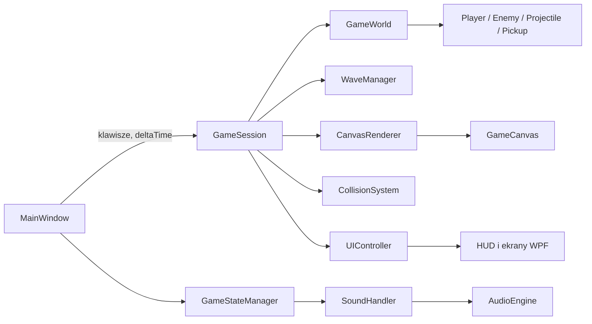

# Space Invaders — dokumentacja techniczna

## 1. Cel i zakres projektu

**Space Invaders** jest jednoosobową grą zręcznościową na Windows, inspirowaną klasycznym *Space Invaders*. Aplikacja jest napisana w C# jako desktopowa aplikacja WPF. Gracz steruje statkiem, eliminuje kolejne fale przeciwników, zbiera ulepszenia i zdobywa punkty. Wynik rekordu jest przechowywany lokalnie.

Projekt obejmuje:

- menu główne z rozpoczęciem gry, samouczkiem, regulacją głośności i modyfikatorami debugowania;
- pętlę gry opartą o odświeżanie WPF;
- generowanie normalnych, rojowych i bossowych fal;
- ruch, strzelanie, kolizje, punkty, mnożnik oraz power-upy;
- renderowanie encji na `Canvas`, HUD, lokalny high score i dźwięk;
- osobny samouczek HTML uruchamiany w domyślnej przeglądarce.

## 2. Wymagania i uruchomienie

| Element | Wartość |
| --- | --- |
| Platforma | Windows (WPF) |
| Framework docelowy | `.NET 10.0` dla Windows |
| Język | C#; ustawiony `LangVersion` 14.0 |
| Zależność zewnętrzna | `NAudio` 3.1.0 — odtwarzanie i miksowanie dźwięku |
| Punkt wejścia | `SpaceInvaders/SpaceInvaders.csproj`, w rozwiązaniu `SpaceInvaders.slnx` |
| Konfiguracje rozwiązania | `Any CPU`, `x64` |

Projekt można otworzyć w Visual Studio albo zbudować z katalogu głównego repozytorium:

```powershell
dotnet build .\SpaceInvaders.slnx
dotnet run --project .\SpaceInvaders\SpaceInvaders.csproj
```

`App.xaml` wskazuje `MainWindow.xaml` jako okno startowe. Pliki w `Resources` są kopiowane do katalogu wynikowego, dlatego aplikację należy uruchamiać wraz z tym katalogiem, a nie przenosić samego pliku wykonywalnego.

> Plik `packages.config` pozostał z wcześniejszej konfiguracji .NET Framework 4.8 i zawiera starszą wersję NAudio. Aktualnie wiążąca konfiguracja zależności znajduje się w `SpaceInvaders.csproj` (`PackageReference` do NAudio 3.1.0).

## 3. Struktura repozytorium

```text
SpaceInvaders/
├── SpaceInvaders.slnx                 # rozwiązanie
├── README.md
├── dokumentacja.md                     # ten dokument
└── SpaceInvaders/
    ├── App.xaml(.cs)                   # aplikacja WPF i start okna
    ├── MainWindow.xaml(.cs)            # widoki, obsługa wejścia i główna pętla
    ├── SpaceInvaders.csproj            # ustawienia projektu oraz zasoby wyjściowe
    ├── Classes/                        # logika domenowa gry
    ├── Resources/
    │   ├── Audio/                      # muzyka oraz efekty WAV
    │   ├── Fonts/                      # czcionka Pixel Digivolve
    │   ├── Images/                     # sprite’y encji i HUD-u
    │   └── Tutorial/                   # samouczek HTML z własnymi kopiami zasobów
    └── Properties/                     # standardowe metadane/ustawienia WPF
```

Katalogi `bin/`, `obj/` oraz `.vs/` są artefaktami kompilacji lub środowiska IDE; nie zawierają źródeł logiki gry.

## 4. Architektura

Projekt ma prostą architekturę sterowaną zdarzeniami. `MainWindow` jest kompozycją aplikacji: tworzy pozostałe serwisy, zbiera klawisze i przekazuje czas pojedynczej klatki do `GameSession`. Sama sesja koordynuje świat gry, fale, kolizje, render i HUD.



### Przepływ pojedynczej klatki

`CompositionTarget.Rendering` wywołuje `MainWindow.GameLoop`. Okno wylicza `deltaTime`, ogranicza je do 0,05 s (ochrona po dłuższej przerwie renderowania) i wywołuje `GameSession.Update`.

W aktywnej fali (`Wave` albo `BossWave`) sesja wykonuje kolejno:

1. odświeża zdrowie w HUD;
2. aktualizuje gracza i jego ruch z klawiszy;
3. przy `Space` tworzy pocisk gracza, jeśli skończył się cooldown;
4. aktualizuje każdego przeciwnika i odbiera jego nowe pociski;
5. przesuwa pociski i usuwa te poza planszą;
6. aktualizuje czas efektu podwójnych punktów;
7. rozwiązuje kolizje, a następnie usuwa nieaktywne pociski i przeciwników;
8. co 0,5 s zmienia klatkę animacji sprite’ów;
9. po wyczyszczeniu fali, po krótkiej przerwie, tworzy następną falę;
10. co 5 s próbuje wygenerować power-up, synchronizuje wizualizację i odświeża HUD.

## 5. Warstwy interfejsu

`MainWindow.xaml` zawiera dwa główne widoki:

- `MenuGrid` — ekran startowy z przyciskami **NEW GAME**, **TUTORIAL**, **OPTIONS** i **EXIT**. Panel opcji zawiera głośność oraz przełączniki debugowe.
- `GameGrid` — plansza `GameCanvas`, teksty fali/wyniku/mnożnika/rekordu, pasek power-upów i pasek zdrowia. Wewnątrz znajduje się nakładka `LoseGrid` z przyciskami MENU, RESTART i QUIT.

Wszystkie przyciski korzystają ze wspólnego stylu `MenuButtonStyle`. Aplikacja używa osadzonej czcionki **Pixel Digivolve**.

`UIController` izoluje kod sesji od konkretnych kontrolek WPF. Przełącza widoki stanów, aktualizuje tekstowy HUD oraz dynamicznie rysuje ikony tarcz, serc i aktywnych power-upów na pomocniczych `Canvas`.

## 6. Stany gry i dźwięk

`GameStateManager` przechowuje bieżący `State` i publikuje zdarzenie `StateChanged`. `SoundHandler` reaguje na zmianę stanu wyborem utworu, a `AudioEngine` odtwarza go w pętli i łagodnie przechodzi między utworami (domyślnie 2,5 s).

| Stan | Znaczenie w obecnej implementacji |
| --- | --- |
| `Menu` | widoczne menu, odtwarzana muzyka menu |
| `Wave` | normalna lub rojowa fala, aktywna logika gry |
| `BossWave` | fala z bossem, aktywna logika gry |
| `Loss` | zakończenie rozgrywki i nakładka porażki |
| `BossAlert`, `Win` | zdefiniowane, ale nie są obecnie ustawiane przez logikę sesji ani obsługiwane wizualnie |

Efekty `click`, `hover`, `shoot`, `explosion` i `pickup` są odtwarzane jako efekty dźwiękowe. `AudioEngine` buforuje pierwszy odczyt danego efektu w pamięci, dzięki czemu kolejne odtworzenia nie wymagają ponownego odczytu pliku.

## 7. Model świata i klasy

| Plik / typ | Odpowiedzialność |
| --- | --- |
| `GameSession` | Koordynuje całą partię: inicjalizację, aktualizację, wynik, koniec gry, nowe fale i tworzenie pickupów. |
| `GameWorld` | Przechowuje `Player`, listy przeciwników, pocisków i pickupów; publikuje śmierć przeciwnika oraz dotarcie do końca planszy. |
| `GameStateManager` | Jedno źródło prawdy o stanie aplikacji. |
| `WaveManager` | Wybiera rodzaj fali, liczbę i rozmieszczenie przeciwników. |
| `Entity` | Bazowa encja z identyfikatorem, pozycją, rozmiarem, szybkością, życiem i klatkami grafiki. |
| `Damageable` | Rozszerza encję o zdrowie, obrażenia i zdarzenie śmierci. |
| `Player`, `Enemy` i ich klasy pochodne | Reguły ruchu, ostrzału, obrażeń oraz parametrów konkretnych jednostek. |
| `Projectile` / `PlayerProjectile` / `EnemyProjectile` | Pociski poruszające się pionowo; frakcja decyduje o stronie kolizji. |
| `Pickup` | Losuje rodzaj i pozycję znajdźki oraz jej sprite’y. |
| `CollisionSystem` | Testuje prostokątne kolizje: pocisk–cel, wróg–gracz i pickup–gracz. |
| `CanvasRenderer` | Utrzymuje odwzorowanie `Entity → Rectangle` i synchronizuje je z `GameCanvas`. |
| `AudioEngine`, `CachedSound`, `LoopStream` | Miksowanie muzyki, cache efektów i pętlenie ścieżek WAV przez NAudio. |

### Renderowanie

Logika nie manipuluje bezpośrednio sprite’ami. `CanvasRenderer.Synchronize` pobiera żywe encje ze świata, dla nowych tworzy prostokąt WPF, ustawia pozycję i wybiera klatkę z `skinFrames`. Usunięte encje mają usuwany odpowiadający im prostokąt. Dzięki temu model gry pozostaje niezależny od kontrolek WPF.

## 8. Sterowanie

| Wejście | Działanie |
| --- | --- |
| `W`, `A`, `S`, `D` | ruch gracza w górę, lewo, dół i prawo |
| `Spacja` | strzał, gdy jest dostępny po cooldownie |
| przyciski menu | rozpoczęcie/restart gry, samouczek, opcje, powrót do menu lub wyjście |

Ruch po przekątnej jest normalizowany, a prędkość jest płynnie zbliżana do docelowej przez interpolację. Po utracie aktywności przez okno zbiór wciśniętych klawiszy jest czyszczony, co zapobiega „zablokowanemu” ruchowi.

## 9. Mechanika gry

### Gracz, obrażenia i punktacja

- Gracz zaczyna z **3 HP**, przy maksymalnym limicie **5 HP**, oraz bez tarczy. Jedna tarcza absorbuje jedno obrażenie, maksymalnie można mieć 5 tarcz.
- Zwykły pocisk przeciwnika zadaje 1 obrażenie. Kolizja z przeciwnikiem przekazuje 2137 obrażeń, co w praktyce kończy grę, chyba że jest aktywny tryb nieśmiertelności.
- Pociski gracza zadają 1 obrażenie. Po zniszczeniu przeciwnika jego wartość punktowa jest mnożona przez bieżący mnożnik oraz ewentualne podwójne punkty.
- Mnożnik zaczyna od `x1,0`, rośnie o `0,02` po każdym zniszczonym przeciwniku i resetuje się do `x1,0` po otrzymaniu obrażeń.
- `highscore.txt` jest odczytywany i zapisywany obok pliku wykonywalnego.

### Przeciwnicy

| Typ | HP | Punkty | Ruch / ostrzał |
| --- | ---: | ---: | --- |
| `Kimi` | 1 | 35 | 60–71 px/s, strzał co 5 s, pocisk 300 px/s |
| `Enemy2` | 3 | 100 | 90–107 px/s, strzał co 4 s, pocisk 200 px/s |
| `Enemy3` | 1 | 150 | 50 px/s, strzał co 8 s, pocisk 50 px/s |
| `Tank` | 3 | 150 | 50 px/s, nie strzela |
| `Boss` | 40 | 5000 | 100 px/s; strzał środkowy i co 3 s dwa boczne pociski |

Wszyscy przeciwnicy poruszają się w poziomie. Po dojściu do krawędzi zmieniają kierunek i schodzą o 51 px. Dotarcie przeciwnika do dolnej granicy planszy kończy partię. Gdy w zwykłej fali pozostają mniej niż 5 przeciwników, ich prędkość jest ustawiana na 250 px/s.

### Fale

Liczba przeciwników w fali normalnej rośnie według funkcji nasycającej od 8 do maksymalnie **32**. Normalna fala losuje `Kimi`, `Enemy2` i `Enemy3`; po wykluczeniu `Enemy3` jest 35% szans na `Enemy2`.

- każda 6. fala, która nie jest falą bossa, jest rojem (`Swarm`): połowa `Enemy3`, połowa `Tank`;
- każda 10. fala jest falą bossa;
- opcja debugowa **Force Boss Wave** zmienia każdą generowaną falę w falę bossa;
- po wyczyszczeniu fali następna zaczyna się po początkowej 1-sekundowej przerwie; przerwa zmniejsza się o 0,02 s po każdej fali.

### Power-upy

Co 5 s jest 40% szans na utworzenie losowego power-upu w środkowej połowie wysokości planszy. Typ jest wybierany równomiernie z czterech wariantów:

| Pickup | Efekt |
| --- | --- |
| `FastShoot` | dodaje 5 s szybszego strzału (cooldown 0,2 s) |
| `BonusPoints` | przez 5 s podwaja naliczane punkty |
| `BonusHealth` | przywraca 1 HP, do limitu 5 |
| `BonusShield` | dodaje 1 tarczę, do limitu 5 |

Kolejne podniesienia szybkiego strzału lub podwójnych punktów kumulują czas działania.

### Modyfikatory debugowania

Są odczytywane przy starcie partii i przekazywane jako maska `Flags`:

- **Force Boss Wave** — wymusza bossa w każdej fali;
- **Invincible** — gracz ignoruje obrażenia;
- **Super Speed** — zwiększa prędkość gracza z 400 do 1600 px/s;
- **Fast Attack** — ustawia cooldown strzału na 0,01 s.

## 10. Zasoby

`Resources/Images` zawiera grafiki gracza, trzech podstawowych wrogów, pocisków, serc, tarcz oraz animowanych pickupów. Sprite’y z kilkoma klatkami są przełączane globalnie co 0,5 s.

`Resources/Audio` zawiera muzykę menu i gry oraz pięć efektów dźwiękowych. `Resources/Tutorial/tutorial.html` jest niezależnym, anglojęzycznym przewodnikiem otwieranym z menu; jego obrazki, styl i font są kopiowane obok pliku wynikowego.

## 11. Ważne uwagi dla rozwoju

Poniższe punkty opisują obecny stan kodu, a nie planowane zachowanie:

- Stany `BossAlert` i `Win` nie mają pełnej implementacji. Dodatkowo `SoundHandler` wskazuje dla nich pliki `bossalert.wav` i `win.wav`, których nie ma w `Resources/Audio`; przejście do tych stanów spowodowałoby problem z odtworzeniem muzyki.
- `SpecialProjectile` jest zdefiniowany (3 obrażenia), ale żadna logika go nie tworzy. Tekst samouczka opisujący taki pocisk nie odpowiada więc obecnej rozgrywce.
- `GameWorld.RemoveInactiveEntities()` usuwa przeciwników i pociski, lecz nie usuwa zebranych pickupów z listy. Nieaktywne pickupy nie są renderowane, ale lista może rosnąć podczas dłuższej sesji.
- `GameWorld.Reset()` nie czyści listy pickupów. Nowa instancja `GameSession` powstaje przy **RESTART**, jednak ponowne rozpoczęcie na istniejącej sesji może zachować pickupy z poprzedniej partii.
- W samouczku podano maksymalnie 64 wrogów w normalnej fali oraz pocisk specjalny; kod ogranicza falę do 32 i obecnie nie używa pocisku specjalnego. Dokumentacja opisuje parametry wynikające z kodu.
- `ReadHighScore()` zakłada, że `highscore.txt` zawiera poprawną liczbę całkowitą. Uszkodzony plik może przerwać start aplikacji; warto w przyszłości zastosować `int.TryParse` oraz obsługę błędów wejścia/wyjścia.

## 12. Gdzie wprowadzać zmiany

| Potrzeba | Najlepsze miejsce |
| --- | --- |
| nowy typ wroga lub parametry istniejącego | `Classes/Entity.cs` |
| zasady kolejności, składu i liczebności fal | `Classes/WaveManager.cs` |
| nowy power-up lub jego efekt | `Classes/Pickup.cs`, `Player.PickUp` w `Entity.cs`, `UIController.cs` |
| reguły kolizji | `Classes/CollisionSystem.cs` |
| pętla rozgrywki, wynik lub zakończenie partii | `Classes/GameSession.cs` |
| wygląd menu, HUD-u albo ekranów | `MainWindow.xaml` i `Classes/UIController.cs` |
| muzyka i efekty | `Classes/SoundHandler.cs`, `Classes/AudioEngine.cs`, `Resources/Audio` oraz `.csproj` |
| instrukcja dla gracza | `Resources/Tutorial/tutorial.html` |

Przy dodaniu zasobu należy umieścić go w odpowiednim katalogu i dodać do `SpaceInvaders.csproj` jako `Content` z `CopyToOutputDirectory="PreserveNewest"`, jeśli ma być ładowany przez ścieżkę względną w czasie działania.
